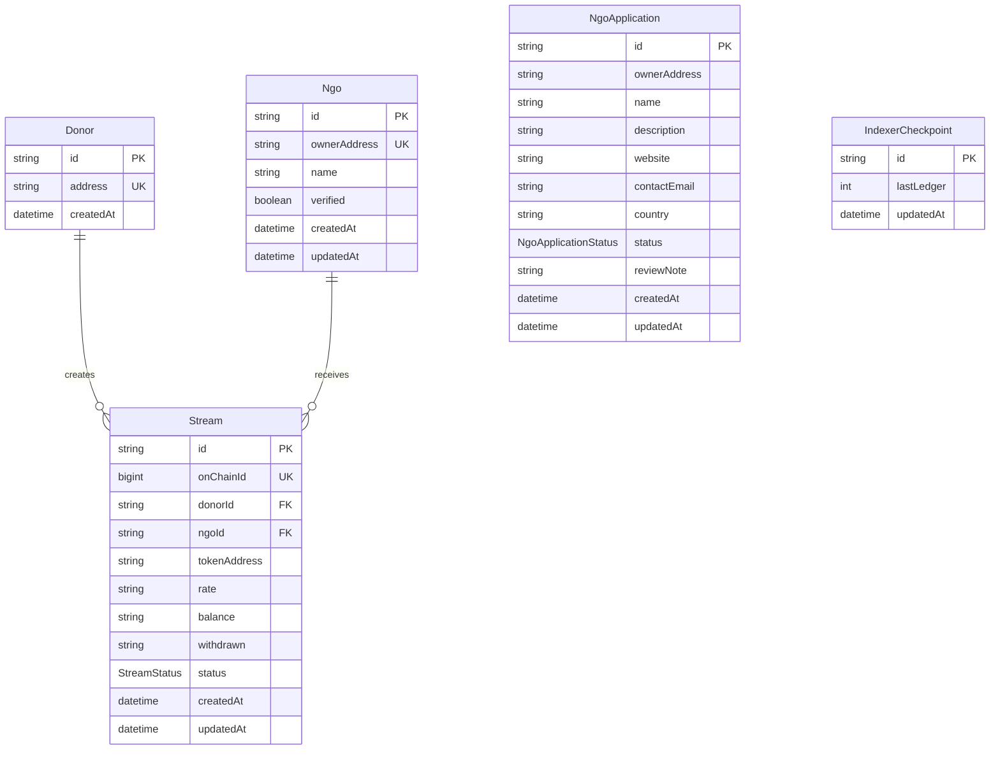

# Data model and API statistics

## Entity relationship diagram

`NgoApplication` is an off-chain review record and currently has no Prisma
relation to `Ngo`; applications are associated by `ownerAddress` in the API.
`IndexerCheckpoint` is a standalone, single-row-per-id table used to resume
event indexing.

## Glossary

- **Donor** — a wallet that creates streams. Identified by its Stellar
  `address`; donors have no on-chain profile beyond that key.
- **Ngo** — an organization that receives streams. `ownerAddress` is its
  Stellar key and the identity used throughout the API. `name` is written by
  the indexer from the registry's `register` event, `displayName` is an admin
  override shown instead of `name` when set, and `verified` mirrors the
  on-chain `approved` flag.
- **Placeholder NGO** — donation-vault does not check registry membership, so
  a stream can reference an address that never registered. The indexer creates
  that `Ngo` row with `name = ''` and `verified = false`. API responses derive
  `registered` from `name !== ''` (not from `verified`) and return `name: null`
  while the stored name is empty. A later `register` event fills in the real
  name.
- **Stream** — a recurring donation from one donor to one NGO, identified by
  the contract's `onChainId` as well as the database `id`. `status` is `ACTIVE`
  until the donor cancels it; cancellation refunds the remaining `balance`.
- **NgoApplication** — an off-chain application from a prospective NGO,
  reviewed by admins (`PENDING`, `APPROVED`, or `REJECTED`). It is not linked
  to `Ngo` by a foreign key; the two are associated by `ownerAddress`.
- **StreamEvent** — the immutable audit log of each indexed contract event, one
  row per event. Used for activity feeds and replaying state changes.
- **IndexerCheckpoint** — the indexer's resume point. A single row records the
  last processed ledger and event id.
- **IndexerDeadLetter** — an event the indexer could not decode or apply.
  Storing it lets the checkpoint advance past the failure instead of blocking
  every later event.
- **NotificationEndpoint** — a configured webhook destination and its event
  filter. **NotificationLog** records each delivery attempt and outcome.
- **Amounts** — `rate`, `balance`, `withdrawn`, and aggregate amounts are
  stored and returned as decimal strings in each token's base units. They are
  never converted to JavaScript `number`; parse them with `BigInt` for exact
  arithmetic. Values for different `tokenAddress` contracts are never summed
  together.

## Derived statistics

Amounts are returned as decimal strings in the token's base units. The API does
not convert or combine values across different `tokenAddress` values.

For a stream, define its committed amount as:

- **Active:** `balance + withdrawn`
- **Cancelled:** `withdrawn`

Cancellation refunds the remaining `balance` to the donor, so that amount was
not committed to or delivered to the NGO. The already-withdrawn amount remains
part of the NGO's committed and withdrawn totals.

### `GET /ngos/:id`

The same detail response is also available from `GET /ngos/lookup?address=...`.
Its `stats` fields are computed from every stream belonging to the NGO:

- `totalCommitted`: sum of each stream's committed amount using the active and
  cancelled rules above.
- `totalWithdrawn`: sum of `withdrawn` across all streams, including cancelled
  streams.
- `activeStreamCount`: number of streams whose status is `ACTIVE`. Cancelled
  streams are excluded.
- `donorCount`: number of distinct donors represented by the NGO's streams;
  cancelled streams are included.

### `GET /impact/:ngoId`

The endpoint computes the same NGO totals from its streams and adds:

- `activeStreams`: count of `ACTIVE` streams.
- `cancelledStreams`: count of `CANCELLED` streams.
- `uniqueDonors`: distinct donor count, including donors whose streams were
  cancelled.
- `platformSharePercent`: `ngoCommitted / platformCommitted * 100`, where both
  values use the committed-amount rules above and `platformCommitted` includes
  every stream in the database. The result is truncated to two decimal places;
  it is `0` when the platform total is zero.

The platform-wide denominator includes cancelled streams only through their
withdrawn amounts, just like the NGO numerator.
